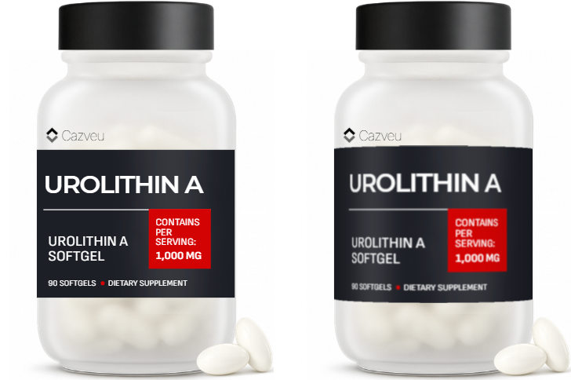

# Label Roller · 瓶身卷标弯曲工具

把平铺的卷标 PNG 卷到圆柱瓶身上，生成亚马逊主图那种“真实贴在瓶子上”的效果：

- 两侧的文字和图案按圆柱透视自然压缩
- 卷标上下沿带弧度（平视 / 略俯视 / 俯视）
- 光影跟随瓶子图：直接取空白瓶子图上卷标位置的明暗印到卷标上，卷标和瓶身光影一致
- 棚拍侧光：内置一条从大牌深色瓶主图上测出来的打光曲线（右侧主光、左侧辅光）
- 纸张颗粒：模拟哑光卷标纸的细小噪点，让卷标像印上去的
- 两侧暗部和竖向高光（手动微调）
- 导出透明底 PNG，可直接拖回 Canva 盖在瓶子上

## 使用方法

**不需要安装任何东西，也不需要联网。**

1. 下载本仓库（绿色 `Code` 按钮 → `Download ZIP`），解压。
2. 双击 `index.html`，用 Chrome / Edge / Safari 打开。
3. 点“上传卷标平铺图”，选你的卷标 PNG。
4. 可选：上传一张不带卷标的空白瓶子图，在工具里直接对位。
5. 调好参数后点“下载 PNG”或“复制图片”（复制后在 Canva 里 Ctrl+V / ⌘V）。

## 卷标没对齐、一边凸出来怎么办

先点第 5 步的 **自动贴合瓶身**：工具会找出瓶子在卷标高度处的左右边缘，让卷标居中、宽度刚好贴住瓶身。瓶子图需要是纯色背景。

只想单独去掉一侧，用第 2 步的 **左侧裁掉 / 右侧裁掉**，导出的卷标也会跟着变窄。

卷标的四个角可以用第 2 步的 **圆角** 滑杆分别调（默认四角联动，取消“四个圆角一起调”后可单独调），按卷标高度的百分比计算，真实模切卷标一般在 1%–3%。

## 保存参数（保持所有产品首图一致）

调到满意后，在「参数预设」里填一个名称，点 **保存参数为 .txt**。文件里记录了全部参数：环绕角度、弧度、光影、瓶身宽度、高度、卷标位置，还有当时用的卷标和瓶子尺寸。

下次做别的产品：上传新卷标 → 点 **读取参数文件**（或直接把 .txt 拖到预览区）→ 导出。只要卷标 PNG 尺寸和瓶子图相同，导出的卷标高度、弧度就完全一致。尺寸不同时工具会提示。

浏览器也会自动记住上次用的参数，下次打开直接恢复。

## 参数建议

| 参数 | 建议 |
|---|---|
| 环绕角度 | 只有正面卷标时 120°–150°；文字离边缘很近时别超过 160° |
| 视角弧度 | 看不到瓶盖顶面选“平视”，能看到一点选“略俯视” |
| 两侧暗部 | 白瓶 25–35，深色瓶可调低 |
| 高度微调 | 环绕角度越大卷标越显高，用它拉回到原来的比例 |

## 说明

- 整个工具是一个 `index.html` 文件，所有处理都在你自己的浏览器里完成，图片不会上传到任何地方。
- 卷标图建议用原始高分辨率 PNG（宽 2000px 以上），导出最大宽度 8000px。
